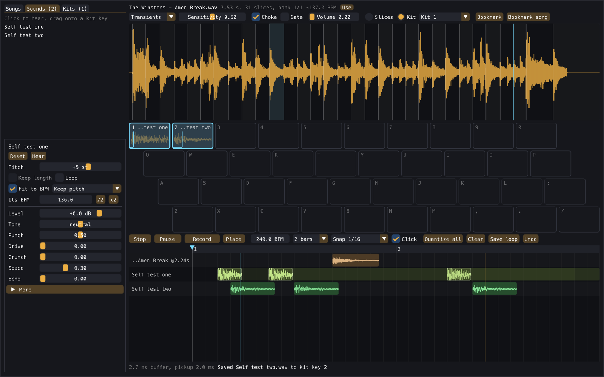

# Amenity

**Chop up songs and breaks, play the pieces from your computer keyboard, and loop them into beats.**

Amenity is a small, fast sampler for making electronic music. Open any track from your music
folder and it's cut into slices at the drum hits. Every slice lands on a key, so you can play
the Amen break like an instrument the moment it loads. Keep the sounds you like, build kits
from them, and record what you play onto a looping timeline that snaps to the beat.



> Amenity is an early release. It's fun to use already, but expect rough edges, and back up
> anything you can't lose.

## Features

- **Automatic chopping.** Songs are sliced at their transients, with a sensitivity slider.
  You can move, add and remove markers by hand.
- **Play from your keyboard.** 40 keys, low latency, with ghost notes, reverse, choke and gate.
- **Kits.** Bookmark any slice as a WAV file, then arrange your sounds across the keys. Make
  as many kits as you like.
- **Looping timeline.** Record with a count-in, or place hits step by step. Takes are snapped
  to the grid and loop so you can keep layering. Select, move, copy, paste and duplicate hits.
- **Tempo detection and fitting.** Each sound's BPM is detected, and loops can be stretched
  or re-pitched to match the timeline.
- **Sound shaping.** Pitch, filter, compression, drive, lo-fi crunch, reverb and a synced echo,
  with simple sliders and a detailed view behind them.
- **Save loops as sounds.** Render a loop to a WAV you can play, chop again, or reopen and edit.
- **Plain files.** Everything you make is an ordinary WAV in your Music folder, ready to use in
  any other software.

## Download

Get the latest version from the [Releases page](https://github.com/groverburger/amenity/releases/latest).

| System | Download | Requirements |
| --- | --- | --- |
| macOS | `Amenity-macOS.zip` | macOS 11 or later, Apple Silicon or Intel |
| Windows | `Amenity-Windows.zip` | Windows 10 (version 1903) or later, 64-bit |

The builds aren't signed yet, so your system will warn you the first time you open Amenity:

- **macOS:** unzip and drag Amenity to Applications, then open it. When macOS says it can't
  check it, go to **System Settings → Privacy & Security** and click **Open Anyway**.
- **Windows:** unzip and run `Amenity.exe`. If SmartScreen appears, click **More info → Run anyway**.

## Getting started

Amenity looks for songs in your **Music** folder (`~/Music` on macOS, `C:\Users\you\Music` on
Windows), including subfolders. Supported formats are WAV, MP3, FLAC, M4A and AAC, plus AIFF
on macOS.

1. **Chop.** Pick a song under **Songs**. Its slices are spread across the keys `1`–`0`,
   `Q`–`P`, `A`–`;` and `Z`–`/`. Play them.
2. **Bookmark.** After playing a slice you like, press `\` and name it. It's saved as a WAV and
   added to the next free key in your kit.
3. **Build a kit.** Repeat with other songs, then press `Tab` to switch to your kit. Drag sounds
   from the **Sounds** tab onto keys, or drag between keys to rearrange them.
4. **Record.** Set the BPM, bars and snap, then press `Return`. After a one-bar count-in,
   everything you play lands on the timeline. It loops so you can keep layering. Press
   `Return` again to stop recording while it keeps playing.
5. **Save.** **Save loop** renders one pass as a new sound. Its hits are saved with it: press
   **Edit** next to it under **Sounds** to put them back on the timeline and change them.

On Windows, use **Ctrl** wherever this guide says **Cmd**, and **Alt** for **Option**.

### More ways to work

**Placing without recording.** Press `'` for Place mode. Each key you press drops its sound at
the cursor and moves on by the snap value. `Left` and `Right` move the cursor, which also makes
rests, and clicking the timeline sets it. Double-clicking a lane adds another hit of that sound.

**Moving and copying hits.** Click a hit to select it, Shift-click to add more, or drag across
empty space to select everything inside. Clicking a lane's name selects all of that sound's
hits. Drag to move the selection, or hold Option while you drag to copy it. Cmd+D repeats the
selection straight after itself, which is quick for turning one bar into four. Cmd+C copies
and Cmd+V pastes at the cursor (the orange line).

**Where playback starts.** Space plays from the blue marker on the ruler. Click the ruler to
move it, and right-click it to go back to the beginning.

**Looping a whole break to your BPM.** Press **Bookmark song**, select it under **Sounds**,
then turn on **Loop** and **Fit to BPM**. Press its key to start it and again to stop it.

## Shaping sounds

The panel on the left shapes whichever sound you played last, and every hit of that sound on
the timeline follows along. Letting go of a slider plays the result, and right-clicking one
resets it.

| Control | What it does |
| --- | --- |
| Pitch | Up or down in semitones. On its own this also changes the speed, like a record. |
| Keep length | Changes the pitch without changing the speed |
| Loop | Repeats until you press the key again, trimmed to whole bars if its BPM is known |
| Fit to BPM | Matches its tempo to the timeline: **Keep pitch** stretches it, **Re-pitch** speeds it up like a record |
| Its BPM | The sound's own tempo, detected for you. If a fit is twice as fast or slow, use `/2` or `x2`. |
| Level, Tone | Volume, and darker or thinner |
| Punch | Compression |
| Drive, Crunch | Saturation, and old-sampler lo-fi |
| Space, Echo | Reverb, and a delay in time with the BPM |

**More** opens the full detail: fine tuning, pan, fades, filter type, every compressor setting,
bit depth, echo timing and reverb size. Changes render in the background and apply from the
next hit, so a sound that's already ringing finishes as it was.

A loop never has silence added to it. If a sound is a little short of a whole number of bars
at its BPM, it's treated as exactly that many bars, played a touch faster. Other lengths are
trimmed to the nearest 16th note.

## Keyboard reference

| Input | Action |
| --- | --- |
| `1`–`0`, `Q`–`P`, `A`–`;`, `Z`–`/` | Play a slice or kit sound |
| Shift + key | Ghost note (quieter) |
| Option/Alt + key | Play in reverse |
| `` ` `` | Pause or resume everything playing. With nothing playing, plays the song. |
| `Tab` | Switch between the song's slices and your kit |
| `-` and `=` | Previous or next kit |
| `'` | Place mode on or off |
| `Left` and `Right` | Move the Place cursor |
| `\` | Bookmark the last slice played |
| `[` and `]` | Previous or next bank, when a song has more than 40 slices |
| `Space` | Play or stop the timeline |
| `Return` | Start or stop recording |
| Cmd/Ctrl + C, X, V | Copy, cut or paste timeline hits. Pasting goes at the cursor. |
| Cmd/Ctrl + D | Repeat the selected hits straight after themselves |
| Cmd/Ctrl + A | Select every hit |
| Cmd/Ctrl + Z | Undo. One undo removes a whole recorded take. |
| Delete | Delete the selected hits |
| `Esc` | Stop everything, discarding a pause, and deselect |

A key lights up while its sound is playing, with a line showing how far through it is.
**Choke** makes a new hit cut off other hits from the same file, so sounds from different songs
layer. **Gate** stops a sound when you release its key, and recording keeps that length.

## Mouse reference

| Where | Action | Result |
| --- | --- | --- |
| Waveform | Click | Play the slice under the cursor |
| Waveform | Shift-click | Play the whole song from there |
| Waveform | Drag a marker | Move it |
| Waveform | Double-click | Add a marker |
| Waveform | Right-click a marker | Remove it |
| Waveform | Scroll up/down, sideways | Zoom, pan |
| Kit key | Right-click | Clear the key |
| Sounds tab | Right-click a sound | Add to kit, rename, or move to the Trash |
| Sounds tab | Edit | Put a saved loop's hits back on the timeline |
| Kits tab | Right-click a kit | Rename, duplicate or delete it |
| Timeline | Click a hit | Select it and hear it. Shift-click adds to the selection. |
| Timeline | Drag a hit | Move the selected hits, snapped to the grid |
| Timeline | Option/Alt-drag a hit | Copy the selected hits |
| Timeline | Drag a hit's right edge | Change how long it plays |
| Timeline | Click empty space | Move the cursor there and deselect |
| Timeline | Drag across empty space | Select the hits inside |
| Timeline | Click a lane's name | Select all of that sound's hits |
| Timeline | Double-click a lane | Add a hit of that sound |
| Timeline | Right-click | Copy, cut, duplicate, delete or paste |
| Timeline ruler | Click | Choose where playback starts |
| Timeline ruler | Right-click | Play from the beginning again |

Changing the sensitivity or slice mode recalculates the slices and discards manual marker
edits. Hits already recorded aren't affected.

## Where your work is saved

Everything lives in `Music/Amenity` in your home folder:

- `Sounds/` holds your bookmarks and saved loops as ordinary WAV files. A saved loop also has
  an `.amenity-loop` file beside it with its hits, which renaming or trashing it takes along.
- `session.amenity` holds your kits, timeline and sound settings, saved automatically.

The session refers to songs by their location. If you move or rename a song, hits from it turn
red on the timeline and stay silent until it's back in place.

## Building from source

You need CMake 3.25 or later and a C++20 compiler: Xcode command line tools on macOS, or
Visual Studio 2022 on Windows. Dependencies are downloaded on the first build.

```sh
cmake -S . -B build
cmake --build build -j --config Release
```

On macOS the app is `./build/amenity`; on Windows it's `build\Release\amenity.exe`. Pass a file
path to open a specific song. Add `-DAMENITY_APP_BUNDLE=ON` on macOS to build `amenity.app`.

```sh
./build/amenity_tests                        # engine, timeline and slicer tests, no audio device needed
./build/amenity --analyze path/to/file 0.5   # print slice times at a given sensitivity
./build/amenity --self-test out.ppm [file]   # silent end-to-end run in a temp folder, saves a screenshot
```

Releases are built by GitHub Actions: pushing a tag like `v0.2.0` builds both platforms and
publishes them. See [docs/DESIGN.md](docs/DESIGN.md) for how Amenity works inside and what's
planned next.

## Built with

[Dear ImGui](https://github.com/ocornut/imgui), [GLFW](https://www.glfw.org),
[miniaudio](https://miniaud.io) and
[Signalsmith Stretch](https://github.com/Signalsmith-Audio/signalsmith-stretch).

## License

[MIT](LICENSE)
